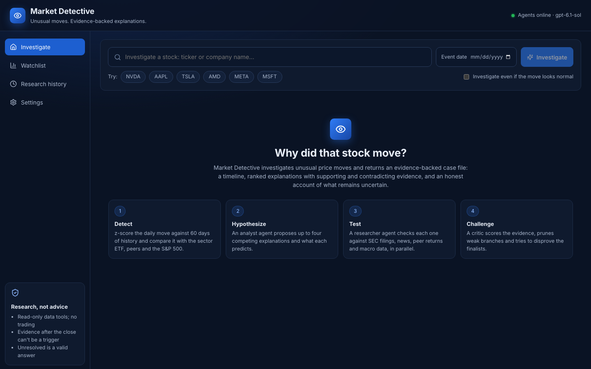
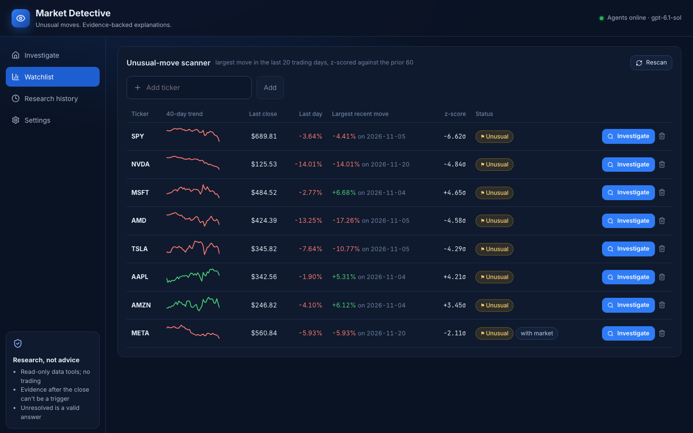
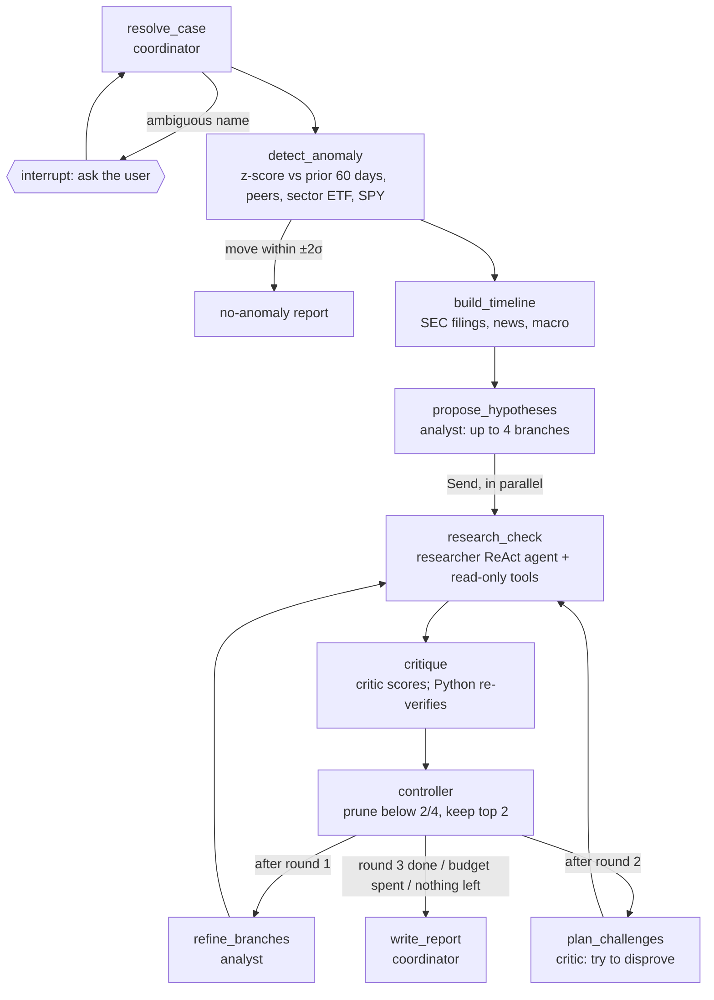

# Market Detective

**An AI research agent that explains why a stock made an unusual price move.**

When a stock suddenly jumps or drops, the first explanation you read is often a guess, such as
"profit-taking" or "investors were disappointed". Market Detective doesn't guess. It detects
the unusual move with statistics, proposes several competing explanations, tests each one
against real evidence (SEC filings, news, peer and sector returns, macro data), lets a critic
agent try to knock them down, and writes a **case file** that separates what is verified from
what is plausible and what is still unknown.

> Built with **LangGraph + LangChain**, **OpenAI** models via `langchain-openai`, **FastAPI** and **React**.



---

## Contents

- [What it does](#what-it-does)
- [Getting started](#getting-started)
- [Using the app](#using-the-app)
- [How it works](#how-it-works)
- [Safety and reliability](#safety-and-reliability)
- [Configuration](#configuration)
- [Project structure](#project-structure)
- [API reference](#api-reference)
- [Troubleshooting](#troubleshooting)
- [Limitations](#limitations)

---

## What it does

| | |
|---|---|
| **Detects unusual moves** | Scores each daily return against the previous 60 trading days (a z-score) and flags moves beyond ±2σ. It also measures how much of the move the S&P 500, the sector ETF and peer stocks shared. |
| **Builds an event timeline** | Pulls SEC filings (with EDGAR acceptance timestamps), news articles and macro data around the event, and labels each item as published *before*, *during* or *after* the move. |
| **Proposes competing explanations** | An analyst agent proposes up to four hypotheses (e.g. guidance cut, sector sell-off, rate move, regulatory news), each stating what evidence it predicts. |
| **Tests them in parallel** | A researcher agent investigates each hypothesis with read-only tools, including semantic search inside filings. |
| **Challenges the finalists** | A critic agent scores every explanation on a 4-point evidence rubric and designs a check meant to *disprove* each finalist. |
| **Writes a case file** | A ranked list of explanations with citations, supporting and contradicting evidence, remaining uncertainty and next steps. It says **"unresolved"** when the evidence isn't there. |
| **Scans a watchlist** | Flags which stocks on your list are acting unusually right now, with one click to investigate. |
| **Answers follow-ups** | Answers questions about a finished case, grounded only in that case's evidence. |



---

## Getting started

### Prerequisites

- **Python 3.11+** and [**uv**](https://docs.astral.sh/uv/) (`brew install uv` or `pip install uv`)
- **Node.js 18+** and npm
- An **OpenAI API key**

### 1. Configure the backend

```bash
cp backend/.env.example backend/.env     # skip if backend/.env already exists
```

Open `backend/.env` and set at least:

```bash
OPENAI_API_KEY=sk-...
SEC_USER_AGENT="MarketDetective/0.1 you@yourdomain.com"   # SEC requires a real contact email
```

The other keys are optional (see [Configuration](#configuration)).

### 2. Start the app in two terminals

**Terminal 1: backend** (FastAPI + LangGraph, http://localhost:8000)

```bash
./scripts/dev-backend.sh
```

**Terminal 2: frontend** (React dashboard, http://localhost:5173)

```bash
./scripts/dev-frontend.sh
```

Then open **http://localhost:5173**.

<details>
<summary>Prefer to run the commands yourself?</summary>

```bash
# Terminal 1
cd backend
uv sync
uv run uvicorn app.api.main:app --reload --port 8000

# Terminal 2
cd frontend
npm install
npm run dev
```

</details>

The first investigation that searches a filing downloads the `all-MiniLM-L6-v2` embedding model
(about 90 MB), so it takes a little longer.

### 3. Check that it's working

- The top-right corner of the app should read **"Agents online · \<model\>"**.
- **Settings** shows which data sources are configured.
- `curl http://localhost:8000/api/config` returns the same information.

---

## Using the app

1. **Investigate a stock.** Type a ticker or company name (e.g. `NVDA` or `nvidia`) and press
   **Investigate**. Leave **Event date** empty to investigate the largest move of the last 20
   trading days, or pick a specific day.
2. **Watch it work.** The case page updates live as the agents run: anomaly statistics, the price
   chart against benchmarks, the hypothesis tree with rubric scores, and an **Agent trace** tab
   showing each step.
3. **Read the case file.** The **Case verdict** panel shows the leading explanation, or says the
   cause is unresolved. Click any citation chip (e.g. `E-3F9A1C`) to open the underlying evidence,
   its source link and when it became public.
4. **Answer clarifications.** If a name is ambiguous (e.g. "apple"), the investigation pauses and
   asks which company you mean.
5. **Ask follow-ups** once the case file is ready, e.g. *"What would change this conclusion?"*
6. **Use the Watchlist** to see which stocks are moving unusually, and **Research history** to
   reopen past cases.

A full investigation usually takes 1–3 minutes, depending on the model and how many evidence
checks it runs.

---

## How it works

### The investigation graph

The workflow is a LangGraph `StateGraph`. State is checkpointed to SQLite after every step, so a
case survives a server restart and can pause for human input.



### Four agent roles

| Role | Job |
|---|---|
| **Coordinator** | Confirms the security, picks peer stocks, and writes the final case file. |
| **Hypothesis analyst** | Proposes distinct explanations and what each predicts, then sharpens the survivors. |
| **Evidence researcher** | A ReAct agent (LangChain `create_agent`) with read-only tools: news search, SEC filing list, semantic filing search, peer/ETF returns and macro data. |
| **Critic** | Scores each explanation on the rubric and designs a final check meant to disprove each finalist. |

### Tree-of-Thought search with a beam of two

| Round | What happens | Evidence checks |
|---|---|---|
| 1. Propose | Up to 4 hypotheses, one check each | ≤ 4 |
| 2. Refine | The 2 strongest survivors are sharpened, up to 2 checks each | ≤ 4 |
| 3. Challenge | One check per finalist designed to disprove it | ≤ 2 |

A case is capped at **10 evidence checks**. Branches scoring below 2/4, or decisively contradicted,
are pruned.

### The evidence rubric

Each explanation earns one point per "yes":

1. **Event documented**: does a source directly document the event?
2. **Timing**: was it public *before* the 4:00 PM ET close of the move?
3. **Price fit**: do the stock, peer, sector and market returns fit the explanation?
4. **Independent support**: is there support from a different *type* of source?

A **leading explanation** needs ≥ 3/4, must pass both the event and timing checks, and must
survive its final challenge. Otherwise the verdict is **unresolved**. A score of 3/4 is *not*
a 75% probability.

### What the LLM decides vs. what code enforces

The model handles judgement. Plain Python handles everything that can be checked mechanically,
so a persuasive model can't override it.

| The LLM (OpenAI) | Python (`backend/app/analysis/`) |
|---|---|
| Proposes and refines hypotheses; plans challenges | Returns, z-scores, beta, abnormal return, move scope |
| Chooses research tools and summarizes findings | Evidence IDs, timestamps and before/during/after labels |
| Judges whether an event is documented and prices fit | **Timing rule**: anything public after the close can't be the trigger |
| Writes the narrative | **Independence rule**: ten articles about one filing count once |
| | **Price-fit guards**: a company-only cause can't explain a move the whole sector shared |
| | Pruning, beam width, budgets and the final verdict |

### Retrieval

SEC filings are fetched on demand from EDGAR, including the press-release exhibits attached to
8-Ks. Each filing is split by section, chunked to about 400 tokens with 50-token overlap, embedded
with Sentence Transformers, and searched by cosine similarity (top 5 passages). There is no
permanent vector database; indexes are cached in memory per filing.

---

## Safety and reliability

- **No trading capability.** Every data tool is read-only.
- **Untrusted content.** Retrieved text is fenced off as data. Instruction-like text (prompt
  injection) is flagged and shown with a warning badge. Citations to evidence IDs that don't
  exist are dropped and noted.
- **Time-aware evidence.** Anything published after the move is labeled *after close* and can
  appear only as commentary, never as the cause.
- **Budgets.** Each case is capped at 10 evidence checks, per-researcher tool and model-call
  limits, an external API-call budget, bounded retries and a timeout. Missing data is recorded as
  an evidence gap, not as evidence against a hypothesis.
- **Data validation.** The app flags possible stock splits in unadjusted prices, gaps in history,
  and dates that weren't trading days.
- **Human in the loop.** Ambiguous companies pause the graph until you choose. A leading
  explanation built on conflicting credible sources is withheld for analyst review.

*Research output, not investment advice.*

---

## Configuration

Settings are read from `backend/.env` and a `.env` at the project root (`backend/.env` wins when
both set a value). Values in these files take precedence over variables exported in your shell,
and blank entries are ignored.

| Variable | Required | Purpose / what happens without it |
|---|---|---|
| `OPENAI_API_KEY` | **yes** | Powers the four agents. Without it, investigations can't start, though the watchlist scan still works. |
| `SEC_USER_AGENT` | **yes** | SEC EDGAR requires an app name plus a real contact email. |
| `LLM_MODEL` | no | OpenAI model ID (default `gpt-6.1-sol`; e.g. `gpt-6-astra` for the flagship). See [OpenAI models](https://developers.openai.com/docs/models). |
| `EFFORT_ANALYST`, `EFFORT_CRITIC`, `EFFORT_RESEARCHER`, `EFFORT_COORDINATOR` | no | Reasoning effort per role (`low`/`medium`/`high`; defaults medium, medium, low, low for speed). Set to empty for models without reasoning effort. |
| `LLM_MODEL_FAST` | no | Optional faster model for the researcher and coordinator (e.g. a "mini" model); the analyst and critic keep `LLM_MODEL`. |
| `SKIP_HOPELESS_CHALLENGES` | no | Default `true`: skip round 3 when no finalist has both a documented event and pre-close timing (none could become leading). |
| `ALPHA_VANTAGE_API_KEY` | no | Primary price source ([free key](https://www.alphavantage.co/support/#api-key)). Falls back to Yahoo Finance. |
| `NEWSAPI_KEY` | no | News search ([free key](https://newsapi.org/register)). Without it, only recent Yahoo headlines are used, so older events get little news. |
| `FRED_API_KEY` | no | Treasury yields, VIX and macro release dates ([free key](https://fred.stlouisfed.org/docs/api/api_key.html)). Without it, macro explanations can't be checked. |
| `ANOMALY_Z_THRESHOLD`, `BEAM_WIDTH`, `MAX_ROUNDS`, `MAX_EVIDENCE_CHECKS`, `MAX_API_CALLS_PER_CASE`, `CASE_TIMEOUT_SECONDS` | no | Investigation limits. The defaults follow the design: 2.0, 2, 3, 10, 120, 900. |

Runtime data (the LangGraph checkpoints, case index and HTTP cache) is stored in `backend/data/`.
Delete that folder to start fresh.

---

## Project structure

```
capstone/
├── scripts/
│   ├── dev-backend.sh        start the API (port 8000)
│   └── dev-frontend.sh       start the UI (port 5173)
├── backend/
│   ├── .env.example
│   ├── pyproject.toml        Python dependencies (managed with uv)
│   ├── app/
│   │   ├── config.py         settings and investigation limits
│   │   ├── models.py         schemas for evidence, anomalies, hypotheses and reports
│   │   ├── data/             HTTP cache and budget; market data, SEC EDGAR, news, FRED clients
│   │   ├── analysis/         anomaly stats, timing classifier, rubric and verdict rules
│   │   ├── retrieval/        section-aware chunking and semantic search over filings
│   │   ├── agents/           prompts, roles, read-only tools, evidence ledger, OpenAI model factory
│   │   ├── graph/            LangGraph state, nodes, graph builder, dependency injection
│   │   └── api/              FastAPI app, background runs with SSE streaming, SQLite store
│   └── tests/                unit tests for the deterministic analysis rules
├── frontend/
│   ├── vite.config.ts        dev server; proxies /api to :8000
│   └── src/
│       ├── pages/            case page, watchlist, research history, settings
│       ├── components/       price chart, verdict, hypothesis tree, timeline, evidence drawer
│       └── lib/              API client (with SSE), types, formatting
└── docs/screenshots/
```

---

## API reference

The backend serves interactive docs at **http://localhost:8000/docs**.

| Method | Path | Purpose |
|---|---|---|
| `POST` | `/api/cases` | Start an investigation: `{"query": "NVDA", "event_date": "2026-11-20", "force": false}` |
| `GET` | `/api/cases/{id}/events` | Server-Sent Events stream: `progress`, `snapshot`, `interrupt`, `done`, `error` |
| `GET` | `/api/cases/{id}` | Full case view (anomaly, evidence, branches, report, messages) |
| `POST` | `/api/cases/{id}/resume` | Answer a clarification: `{"value": "AAPL"}` |
| `POST` | `/api/cases/{id}/ask` | Follow-up question grounded in the case file |
| `GET` | `/api/cases` | Research history |
| `GET` | `/api/scan` | Anomaly scan of the watchlist (no LLM) |
| `GET` / `POST` / `DELETE` | `/api/watchlist` | Manage the watchlist |
| `GET` | `/api/config` | Configured keys, model and limits |

Example:

```bash
curl -X POST localhost:8000/api/cases -H 'content-type: application/json' -d '{"query":"NVDA"}'
curl -N localhost:8000/api/cases/<case_id>/events
```

Run the unit tests with `cd backend && uv run pytest`.

---

## Troubleshooting

| Symptom | Fix |
|---|---|
| Top-right shows **"LLM key missing"** | Set `OPENAI_API_KEY` in `backend/.env` (or a `.env` at the project root); the backend reloads automatically. |
| `401 Incorrect API key provided` | The key being used is invalid. Keys are read from `backend/.env`, then the project-root `.env`, then shell variables. `.env` files win over `export OPENAI_API_KEY=...` in `~/.zshrc`, but an old exported key is still used if neither `.env` sets one. |
| Top-right shows **"API offline"** | The backend isn't running on port 8000. Start `./scripts/dev-backend.sh`. |
| `Address already in use` | Another process holds port 8000 or 5173. Find it with `lsof -i :8000` and stop it. |
| SEC requests fail with 403 | Set `SEC_USER_AGENT` to an app name plus a real email address. |
| Case fails with a model error | Check that `LLM_MODEL` is a model your OpenAI account can use. If the model doesn't support reasoning effort, set the `EFFORT_*` variables to empty. |
| Old events show no news | NewsAPI's free tier covers about the last month; without a key, only very recent Yahoo headlines are available. |
| `uv: command not found` | Install uv: `brew install uv` or `pip install uv`. |

---

## Limitations

- Daily data only: the move is measured close-to-close, so intraday timing within a day isn't analyzed.
- Free news sources have short history windows, so older events depend mostly on SEC filings and market data.
- Rubric scores measure evidence conditions, not the probability that an explanation is the cause.
- Agents share one model, so their agreement isn't fully independent verification. The design
  relies on primary sources, timestamps and deterministic checks instead.
