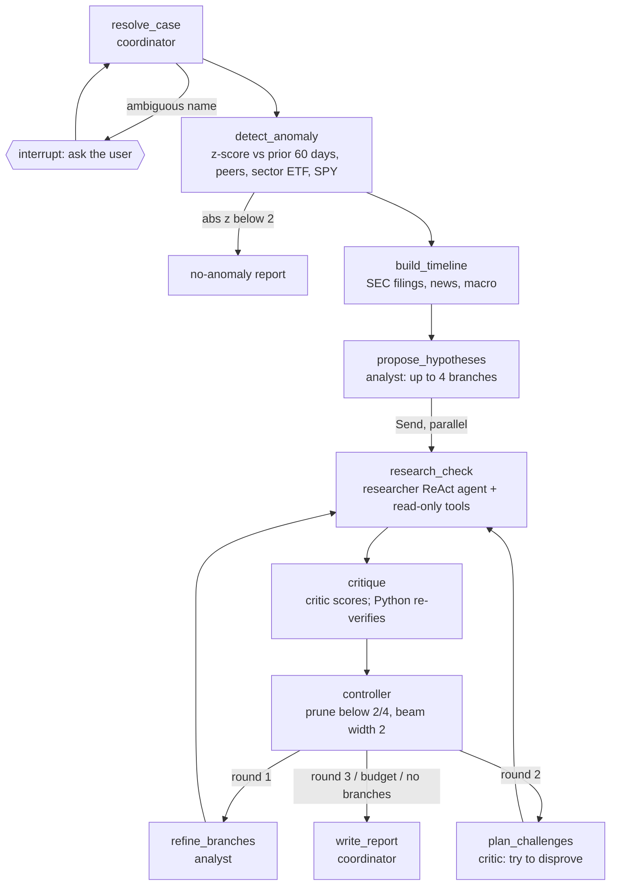

# Market Detective

An AI research agent that investigates **why a stock made an unusual price move** and returns an
evidence-backed case file: the move and how it compares with peers, a timestamped event timeline,
competing explanations ranked by a four-point evidence rubric, citations, and an explicit account
of what remains uncertain.

Built with **LangGraph + LangChain** (OpenAI ChatGPT models via `langchain-openai`), **FastAPI**, and a
**React** dashboard. It implements the CMU AGT capstone design from Weeks 2–6.

## Quick start

```bash
# 1. Backend (Python 3.11+, uv)
cd backend
cp .env.example .env            # add OPENAI_API_KEY and SEC_USER_AGENT (others optional)
uv sync
uv run uvicorn app.api.main:app --reload --port 8000

# 2. Frontend (Node 18+)
cd frontend
npm install
npm run dev                     # http://localhost:5173 (proxies /api to :8000)
```

The first filing search downloads the `all-MiniLM-L6-v2` embedding model (~90 MB).

| Key | Required | Without it |
|---|---|---|
| `OPENAI_API_KEY` | yes | investigations can't start (the watchlist scan still works) |
| `SEC_USER_AGENT` | yes | SEC asks for an app name + contact email |
| `ALPHA_VANTAGE_API_KEY` | no | prices come from Yahoo Finance (yfinance) |
| `NEWSAPI_KEY` | no | only recent Yahoo headlines are searched (older events get little news) |
| `FRED_API_KEY` | no | the macro hypothesis can't be checked against yields/VIX/releases |

## How an investigation runs



**Four roles (Week 5):** coordinator/report writer, hypothesis analyst, evidence researcher,
critic. Hypotheses are branches in shared state, not extra agents.

**Tree of Thought with beam search (Week 4):** round 1 proposes up to four explanations with
one check each; round 2 refines the two survivors with up to two checks each; round 3 runs one
disconfirming check per finalist. At most 10 evidence checks per case.

**What the LLM decides vs. what Python enforces:**

| LLM (OpenAI) | Python (deterministic, `app/analysis/`) |
|---|---|
| propose / refine hypotheses, plan challenges | returns, z-scores, beta, abnormal return, scope |
| choose tools and summarize findings | evidence ids, timestamps, timing classification |
| judge whether an event is documented and prices fit | timing check: evidence after the 4:00 PM ET close can't be the trigger |
| write the narrative | independence: support must span 2+ source *kinds* |
| | price-fit guards (a company-only cause can't fit a sector-wide move) |
| | pruning, beam width, budgets, leading/unresolved verdict |

A **leading explanation** must score ≥ 3/4, pass the event and timing checks, and complete a
final challenge. Otherwise the case file says the cause is **unresolved**.

## Safety and reliability (Week 6)

- Read-only data tools only; no trading capability.
- Retrieved text is fenced as untrusted data; instruction-like content is flagged `possible_injection`
  and shown in the UI. Citations to evidence ids that don't exist are dropped and noted.
- Runtime limits: 10 evidence checks, per-researcher tool/model-call caps, a per-case API-call budget,
  bounded retries, and a case timeout. Missing data is recorded as a gap, not as evidence against.
- Data validation: split-ratio detection on unadjusted prices, gaps in history, non-trading dates.
- Human in the loop: ambiguous securities pause the graph (`interrupt()`) until the user picks one;
  a leading explanation backed by conflicting credible sources is withheld for analyst review.
- State is checkpointed to SQLite after every step, so cases survive restarts.

## Retrieval (Week 3)

SEC filings are fetched on demand from EDGAR (8-K press-release exhibits included), split by
section, chunked to ~400 tokens with 50-token overlap, embedded with Sentence Transformers, and
searched by cosine similarity (top 5). There's no permanent vector database; indexes are cached
in-process per filing. EDGAR acceptance timestamps (UTC) drive the timing check.

## Project layout

```
backend/app/
  config.py            settings + investigation limits
  models.py            evidence, anomaly, hypothesis and report schemas (also LLM output schemas)
  data/                http cache + budget, market (Alpha Vantage/yfinance), SEC EDGAR, news, FRED
  analysis/            anomaly stats, timing classifier, rubric scoring + verdict rules
  retrieval/           section-aware chunking + semantic search over filings
  agents/              prompts, roles, read-only tools, evidence ledger, OpenAI model factory
  graph/               LangGraph state, nodes, builder, injected dependencies
  api/                 FastAPI app, SSE run manager, SQLite store
frontend/src/
  pages/               case page, watchlist scanner, history, settings
  components/          price chart, verdict, hypothesis tree, timeline, drawer, clarify modal
```

## API

| Method | Path | Purpose |
|---|---|---|
| POST | `/api/cases` | start an investigation `{query, event_date?, peers?, force?}` |
| GET | `/api/cases/{id}/events` | SSE stream: `progress`, `snapshot`, `interrupt`, `done`, `error` |
| POST | `/api/cases/{id}/resume` | answer a clarification `{value: "AAPL"}` |
| POST | `/api/cases/{id}/ask` | follow-up question grounded in the case file |
| GET | `/api/scan` | z-score scan of the watchlist (no LLM) |
| GET | `/api/cases`, `/api/cases/{id}`, `/api/config`, `/api/watchlist` | history, case view, config, watchlist |

*Research output, not investment advice.*
