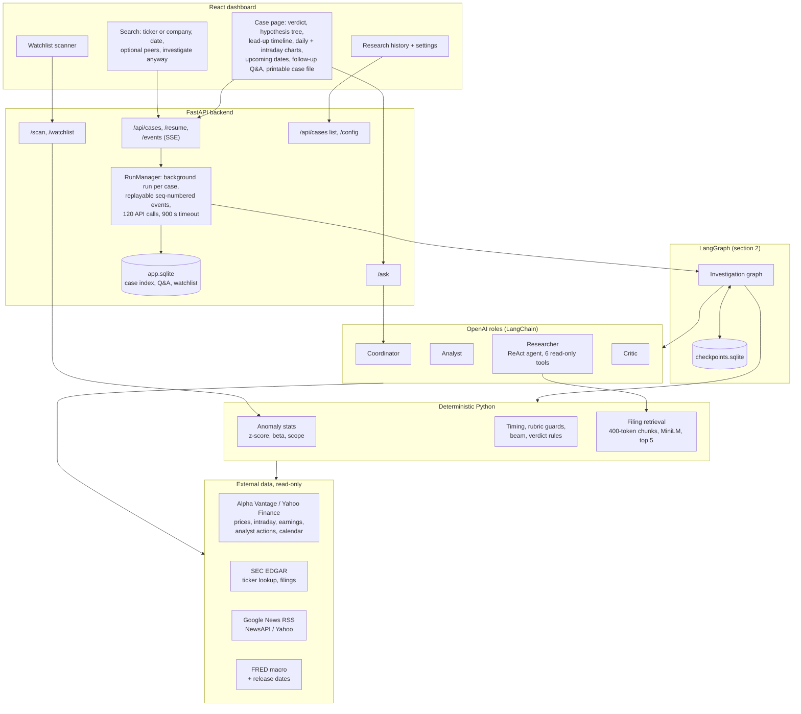
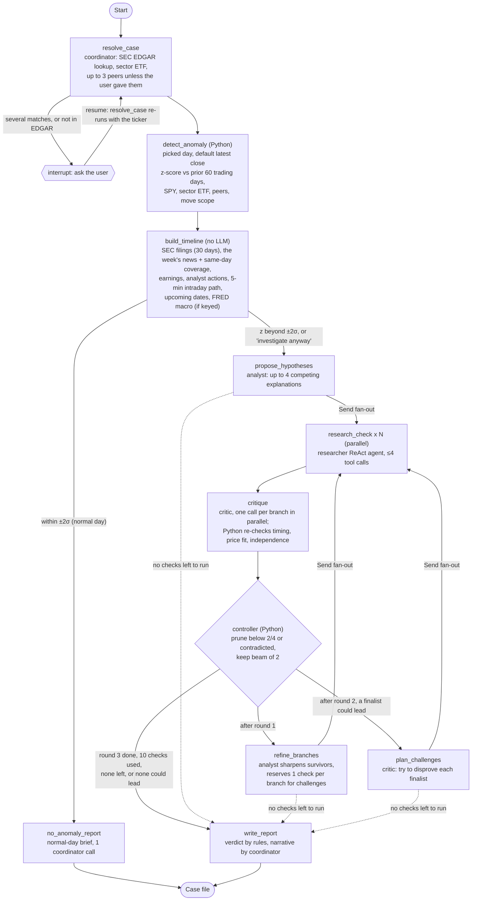
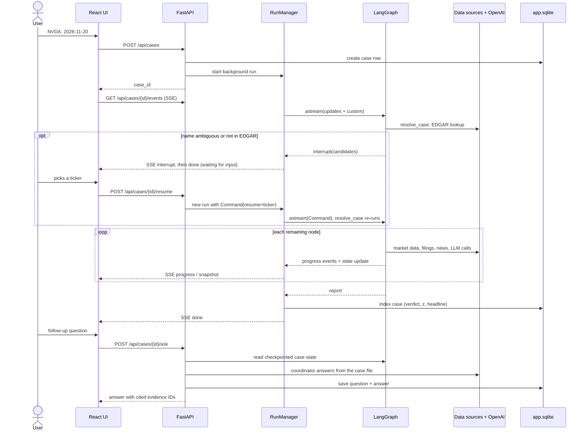

# Market Detective architecture

Five views: the system as a whole, the LangGraph investigation, one request from start to
finish, who decides what (LLM vs. Python), and the researcher's tools.

## 1. System overview

## 2. Investigation graph (LangGraph)

**Budgets:** ≤10 evidence checks per case, ≤4 tool calls per researcher, 120 API calls and a
900 s timeout per case, 2 attempts per LLM node.

**Pruning:** below 2/4 or decisively contradicted; the beam keeps 2. If every branch fell short
only for missing evidence, the best 2 stay on provisionally before round 3.

**Leading explanation:** score ≥3/4 with a documented event, public before the 4:00 PM ET
close, a completed challenge, and no decisive contradiction.

**Verdicts:** `leading`; `needs_review` when a leading explanation's credible sources conflict;
`shared_move` when nothing leads but prices show the move was mostly sector- or market-wide;
`unresolved` otherwise; `no_anomaly` for normal-range days.

## 3. One investigation, end to end

## 4. What the LLM decides vs. what code enforces

| OpenAI roles | Deterministic Python |
|---|---|
| Coordinator: pick peers, write the case narrative, normal-day brief and follow-up answers | Returns, z-scores, beta, abnormal return, move scope, intraday path |
| Analyst: propose and refine hypotheses | Evidence IDs, timestamps, before/during/after labels |
| Researcher: choose tools and queries, summarize findings | Timing rule: after-close items can't be the trigger |
| Critic: judge event documented, price fit, independent support; plan challenges | Drops nonexistent cited IDs; independence needs ≥2 source kinds; price-fit guards |
| | Pruning, beam, budgets, routing, final verdict |

## 5. Researcher tools

| Tool | Source | Returns |
|---|---|---|
| `search_news` | Google News RSS, NewsAPI, Yahoo | Articles around the event date, labeled before/during/after |
| `list_sec_filings` | SEC EDGAR | 8-K, 10-Q, 10-K and others near the event, with acceptance times |
| `search_sec_filing` | SEC EDGAR + MiniLM | Top 5 passages from one filing and its press-release exhibit |
| `get_daily_returns` | Alpha Vantage / Yahoo | Same-day returns for up to 6 peers, ETFs or indices |
| `get_macro_context` | FRED | Treasury yield and VIX moves, macro releases in the 3 days before |
| `get_earnings_and_analyst_actions` | Yahoo Finance | Latest EPS vs consensus, recent upgrades and downgrades |
