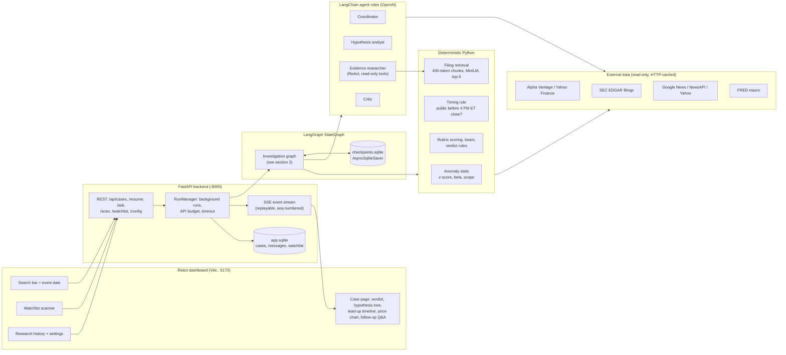
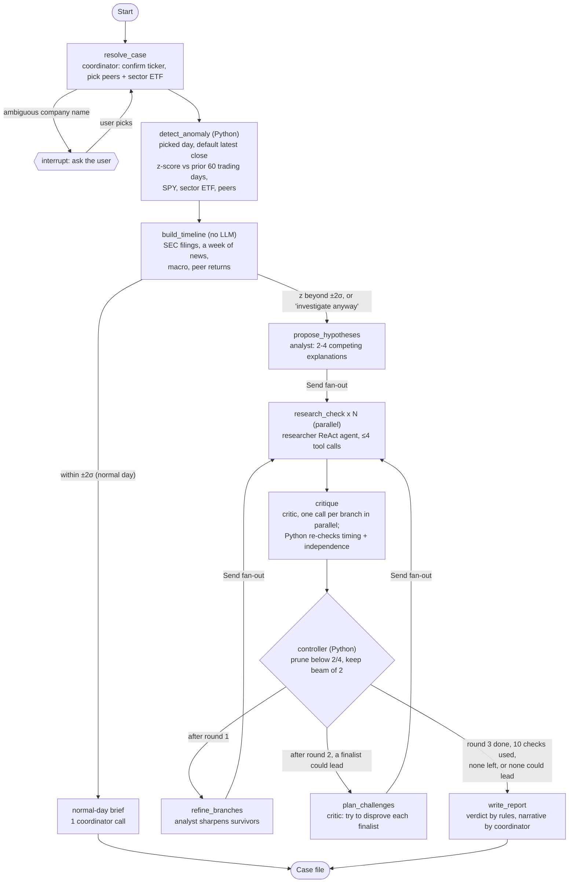
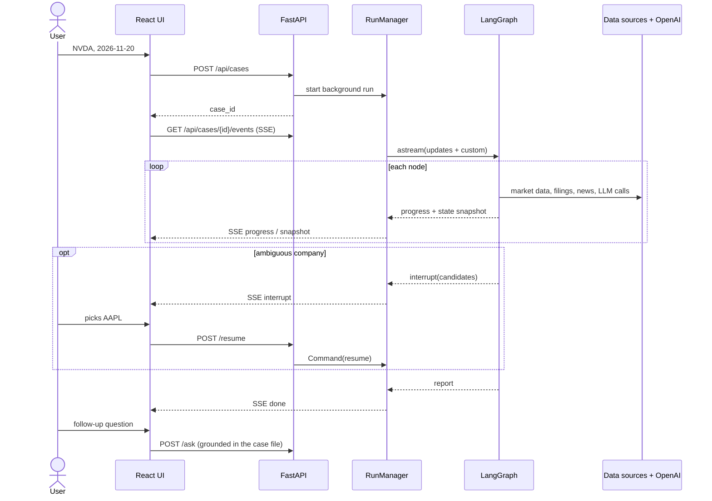

# Market Detective architecture

Four views: the system as a whole, the LangGraph investigation, one request from start to
finish, and who decides what (LLM vs. Python).

## 1. System overview

## 2. Investigation graph (LangGraph)

**Budgets:** ≤10 evidence checks per case, ≤4 tool calls per researcher, an API-call
budget, and a case timeout. **Leading explanation:** score ≥3/4 with a documented event,
public before the close, plus a completed challenge. Otherwise the verdict is "unresolved".

## 3. One investigation, end to end

## 4. What the LLM decides vs. what code enforces

| OpenAI agents | Deterministic Python |
|---|---|
| Pick peers, propose and refine hypotheses, plan challenges | Returns, z-scores, beta, abnormal return, move scope |
| Choose research tools, summarize findings | Evidence IDs, timestamps, before/during/after labels |
| Judge whether an event is documented and the prices fit | Timing rule: after-close items can't be the trigger |
| Write the "why it moved" text, summary and key-event headlines | Independence rule, price-fit guards, pruning, beam, budgets, final verdict |
